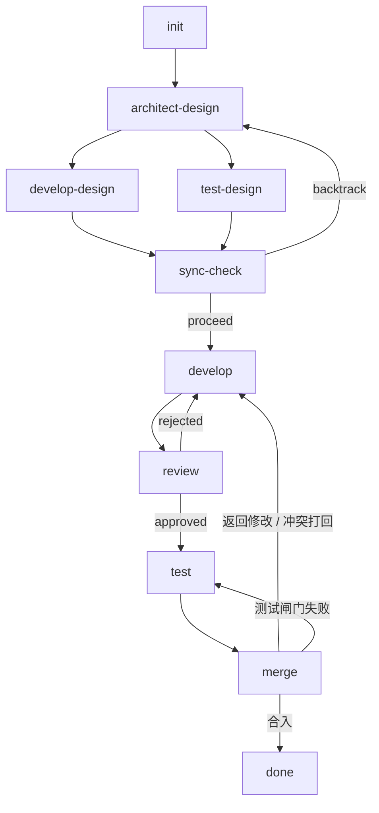
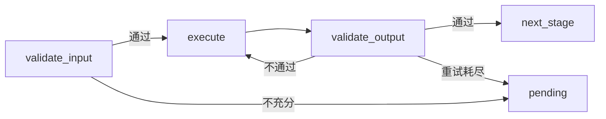

<div align="center">

# AgentPipeline

### 像素机房 · 夜班流水线

把你的一句话需求丢上流水线，从**架构设计 → 开发 → 评审 → 测试 → 合并**都由一队本地 agent 自己跑；
你只在它卡住时拍板。

[](https://github.com/745846739/AgentPipeline/actions/workflows/check.yml)
[](LICENSE)
[](rust-toolchain.toml)
[](frontend)


<sub>看板即流水线：每一列是一个阶段，卡片带着它在流水线上的实时位置与阻塞原因。</sub>

</div>

---

## 这是什么

**AgentPipeline 是一个跑在本机的多 agent 开发管线。** 你在看板上新建一张卡（一句话需求），它会被拆进一条固定的十阶段流水线，由不同角色的 agent 依次接手：拆需求、出架构、并行写开发方案与测试方案、实现代码、评审、跑测试、合入。整个过程你只做两件事——**看图**，和它卡住时**拍板**。

它是为「一个人想同时推进好几件事、又不想把方向盘交出去」的场景设计的：

- **流水线是确定的，agent 是受限的。** 越界、重试、打回、汇聚都由代码里的状态机管；agent 只在需要语义判断的节点被调用，产出必须是结构化数据，不允许自由文本在节点间漂移。
- **一切都在本机。** 单二进制、内嵌前端、SQLite，数据全落在 `~/.agentpipeline/`。你的代码和会话不出这台机器（除非你自己把它暴露到局域网）。
- **它只在真需要你的时候打扰你。** 其余时间它自己往下走；「一个事件只打扰人一次」是写进调度器的硬约束。

## 特性

- **🎯 流水线即看板** — 十阶段 DAG（`init → architect-design → develop-design / test-design → sync-check → develop → review → test → merge → done`）直接渲染成一排泳道；任务卡的列位、游标、阻塞原因一眼可见。
- **🧵 真并行 + 汇聚屏障** — 设计阶段两条独立游标并行推进（各自看各自的边界），`sync-check` 在所有游标都到达边界后只执行一次。
- **🗣 值班长 · 对讲台** — 一个任务无关的对话 agent，向你汇报夜班态势、能读能提议；**改状态的动作一律生成「提议」等你按键**，它给建议、你拍板（见下）。
- **📦 本地优先 · 单二进制** — 前端 `dist` 在编译期内嵌，`cargo build --release` 出一条可执行文件；axum 同源托管 UI 与 API，打开 `http://127.0.0.1:8788` 即用。没装 Node 也能编译（退化为「前端未构建」提示页）。
- **🖥 桌面 App + 手机扫码** — 可打包成 Tauri 桌面壳（dmg），也能让同局域网的手机扫码看板（写操作需配对）。
- **🛡 质量闸门即 CI** — `make check = lint + test + frontend + e2e`；GitHub runner 上跑的是**同一套 `make` 命令**，部署挂在闸门结论之后。
- **🔍 可观测性内置** — 后端一条 SSE 事件流驱动全程；指标页给出成功率 / 各阶段耗时 / 重试率 / 首过率 / 逃逸事件。
- **🧬 异族复判（防错误放大）** — 设计类节点的自动判定若判「不合格」，会先请**另一个厂商**的强档模型复判一次；分歧上交人工终审，而不是顺着单一模型的自负越走越远。
- **🔒 worktree 隔离** — 每个任务一个 git worktree，互不踩脚；git 能力由 git2（libgit2）提供，无需系统 git。
- **🧪 确定性、可测试** — 默认测试门**不打真网络**（真 LLM / 真 GitHub 都是 `#[ignore]` + 环境变量的双锁），CI 里不需要任何 secret。

## 界面

<table>
<tr>
<td width="50%"><br/><sub><b>对讲台</b> — 与值班长对话；它把待拍板的事编成提议卡，动手指令等按键。</sub></td>
<td width="50%"><br/><sub><b>任务详情</b> — 时间线、会话、命令、产出文件、diff 一屏到底；合入前看清每一处改动。</sub></td>
</tr>
<tr>
<td width="50%"><br/><sub><b>手机访问</b> — 同一 Wi-Fi 扫码即可看板；二维码自带配对令牌。</sub></td>
<td width="50%"><br/><sub><b>全局指标</b> — 成功率、各阶段耗时与重试率、首过率、逃逸事件。</sub></td>
</tr>
</table>

## 快速开始

### 依赖

- **Rust 1.80+**（仓库根的 `rust-toolchain.toml` 钉住精确版本 `1.98.0`，首次构建自动下载一次）
- **Node.js** — 只有构建前端时需要；不装也能编出 API 可用的后端
- 无需系统 `git`（走 git2 / libgit2），无需单独安装 SQLite（sqlx 内嵌编译）

### 跑起来

```bash
git clone https://github.com/745846739/AgentPipeline.git
cd AgentPipeline
make hooks     # 接管 pre-commit 闸门（新克隆 / 换机后先跑一次）
make run       # 前端构建 → 编译 → 启动，浏览器打开 http://127.0.0.1:8788
```

首次启动后，到界面「**模型与密钥**」页配置一个 provider（DeepSeek / OpenAI / Anthropic 等），才能新建任务——未配置时创建会明确报错。

<details>
<summary>手动等价命令 / 前端热更开发</summary>

```bash
# 等价于 make run
cd frontend && npm ci && npm run build && cd .. && cargo build --release

# 前端热更（vite 把 API 代理到本机 axum）
cd frontend && npm run dev
```

</details>

### 桌面 App

```bash
make desktop       # 出 dmg → crates/desktop/target/release/bundle/dmg/
make desktop-run   # debug 壳直接跑
```

桌面壳只是外壳：壳内起的是同一个同源服务，端口沿用配置（缺省 `8788`）、跨重启不变，所以二维码、手机书签、桌面窗口地址永远指着同一个号码。

### 手机访问与局域网

桌面壳或 web 形态都能让手机接入。打开应用内「**手机访问**」页扫二维码即可；只读页面（看板 / 会话 / 指标 / 分享页）扫开就能看，**写操作与对讲台需要配对**。

```bash
# web：绑定全网卡后到「手机访问」页扫码
./target/release/agent-pipeline serve --host 0.0.0.0

# 桌面壳：设环境变量开启局域网（默认仍只绑回环）
AGENTPIPELINE_LAN=1 make desktop-run
```

> ⚠️ **安全边界**：绑定**非回环**地址时，所有写请求与 `/foreman/*` 需要配对令牌（`X-AgentPipeline-Token`，缺失即 403「这台设备还没配对」）；令牌长期有效，本机 `GET /pairing/token` 读取（仅回环可读）、`POST /pairing/reset` 一键重置。默认回环绑定（本机使用）不要求配对。只读页面里的任务是明文展示的、同网段可看——**服务能触发真实 LLM 调用并读取全部会话，请勿在公共 Wi-Fi 下开启**，更稳妥可用 SSH 隧道 / Tailscale。

若要让**另一台电脑的浏览器**直接打开本机页面（页面 origin 与 API 不同源），才需要显式放行该 origin：

```bash
./target/release/agent-pipeline serve --host 0.0.0.0 --allowed-origin http://192.168.1.10:8788
```

`127.0.0.1` / `localhost` 恒放行，前缀伪装（`...:8788.evil.com`）始终被拦；跨源防护只拦异源写请求。完整交代见 [docs/operations.md](docs/operations.md) §12.16。

## 工作原理

每个任务是一条固定的 DAG。设计阶段两条游标并行，之后汇聚进入串行链路；评审与合入失败会按类型打回上游。



**每个阶段内部是三个节点**，重试与阻塞都在这里收口：



几条贯穿全局的约束：

- **无状态节点** — 节点不持内部状态，产出写进任务目录文件，靠文件路径在节点间传递信息。
- **结构化流转** — 节点间信息必须符合数据模型定义，不允许自由文本。
- **代码优先** — 固定流程（状态流转、数据组装、文件操作）用代码实现，只在需要语义分析 / 判断时才接 agent。
- **执行位置的唯一事实源是游标** — 串行阶段一条 `main` 游标，并行阶段两条；进程重启后据游标行恢复。

卡住的任务进入 `pending`（带原因：输入不充分 / 冲突等待 / 重试耗尽 / 合并审批 / 环境受阻…），你在看板上按恢复动作（继续 / 跳过 / 跳转）放行即可。

## 值班长 · 对讲台

对讲台是这个项目最像「有人值夜班」的那部分：一个**任务无关**的对话 agent，向你汇报当前夜班态势并给出建议。它的边界写死在实现里——

- **它能读、能提议。** 深挖时自己调只读工具（台账 `read_task` / `read_conversation`、环境读数 `read_board` / `read_metrics` / `read_stage_configs` …），每轮拿到一份态势快照。
- **它动手要你按键。** 文件与命令这两层由**权限档位**管（`ask` 每次生成提议等你按确认钮 → `auto` 直接执行 → `deny` 连工具都看不到）；而本服务自己的写接口（建任务 / 拍板 / 合入 / 改配置 / 装技能）**恒为提议**，不看档位。
- **它的回复里永远没有按钮。** 确认钮在提议那一轮、选项钮在提问轮——都在时间线里，不在回复文本里。
- **故意缺席的动作**：重置配对令牌、局域网开关、仓名单增删——判据是「改的是**谁能访问这台机器**」，这类事连工具名都没有。

## 可靠性与可观测性

- **质量闸门**：`make check` 一次跑齐 lint（`fmt --check` + `clippy -D warnings`）、Rust 全量测试、前端（vitest + svelte-check + build）、Playwright E2E。Makefile 是闸门的**唯一权威定义**，本地与 CI 调的是同一批 `make` 目标。
- **产物新鲜度守卫**：E2E 跑用例前先确保被测对象是当前源码（前端源码更新则重建 dist，二进制随之重编），杜绝「改了代码不重建得到的绿」。
- **单条事件流**：后端只有一条 SSE 事件流，类型契约集中在一处，前端据此实时刷新看板与时间线。
- **中止即收口**：手动暂停会让在飞的那一轮收口、游标挂起并**保留位置**，而不是丢掉当前进度。
- **判断力不外包给单一模型**：设计类自动判定不合格时走异族复判，分歧交人工。

当前状态：`make check` 的四道闸（lint / test / frontend / e2e）在 CI 上全绿——要真数，跑一遍 `make check` 就有；动态结论看仓库顶部的 check 徽章。

## 项目结构

```
crates/core/     核心库
  pipeline/      图拓扑、条件边路由、落点表、游标谓词
  agent/         LLM 接缝、工具执行、结构化输出解析、上下文压缩、prompt 组装
  storage/       SQLite（sqlx migrations）、游标生命周期、冲突比对、旁路动作事务
  scheduler/     KanbanScheduler.tick 六项职责
  git.rs         git2 封装（worktree / rebase / 合入写回 / 重置清理 / 项目探测）
  actions.rs     allowed_actions 权威表与端点配对
  sse.rs         唯一事件流的类型契约
crates/app/      二进制 + axum router（lib 形态供 tower oneshot 测试）
crates/desktop/  Tauri 桌面壳（独立 workspace）
crates/testkit/  测试基建：临时 home、git fixture、FakeAgent、断言助手
frontend/        Svelte 5 + Vite（像素主题，深浅两套）
tests/e2e/       L4 场景
```

五条可测试性接缝已就位：`Clock` trait、`AGENTPIPELINE_HOME` 隔离、`ProcessKiller` trait、手动驱动的 `scheduler.tick()`、仓访问的远端地址替换点。

## 文档

设计文档是**唯一事实来源**，入口见 [docs/README.md](docs/README.md)：

| 文件 | 内容 |
|---|---|
| [docs/overview.md](docs/overview.md) | 流程图、全局约束（G1–G15）、全局配置参数表 |
| [docs/data-model.md](docs/data-model.md) | 任务主结构、阶段输入输出、Pending → Resume 映射 |
| [docs/pipeline-spec.md](docs/pipeline-spec.md) | 各节点详细流程、并发分支同步、幂等性、异常处理 |
| [docs/agents.md](docs/agents.md) | Tool 定义、各节点 Prompt 模板、阶段级 Agent 配置 |
| [docs/implementation.md](docs/implementation.md) | 流水线拓扑、executor、KanbanScheduler、数据库表 |
| [docs/operations.md](docs/operations.md) | worktree、成本、取消、可观测性、通知、锁、配对与局域网、HTTPS 入口 |
| [docs/testing.md](docs/testing.md) | 测试设计：可测试性接缝、FakeAgent/testkit、各层用例目录、质量闸门 |
| [docs/decisions.md](docs/decisions.md) | 决策日志（#1–#430，只追加；「为什么这样定」都在这） |
| [docs/glossary.md](docs/glossary.md) | 领域术语表 |
| [design/frontend-design.md](design/frontend-design.md) | 前端交互骨架与页面元素（视觉方向：像素机房） |

## 开发

```bash
make check           # 提交前必过：lint + test + frontend + e2e
make check-lint      # cargo fmt --check + cargo clippy -D warnings
make check-test      # 全量测试（L1 单元 + L2 集成 + L3 API + L4 场景 + 冒烟）
make check-frontend  # vitest + svelte-check + vite build
make check-e2e       # Playwright E2E（前置产物新鲜度守卫）
make unit integration api smoke   # 分层子集
make sweep           # 只清可再生的构建缓存（保留第三方 rlib）
```

提交受 pre-commit 钩子接管（跑 lint 层），所以**克隆 / 换机后先跑一次 `make hooks`**。改动前请读 [docs/testing.md](docs/testing.md) 的用例目录与五条可测试性接缝；界面层的可追溯性走 [design/frontend-design.md](design/frontend-design.md) §12.3 的「行为 / 规则 → 实现位置」表。

## 许可

[MIT](LICENSE) © 2026 泽运

<div align="center"><sub>用 Rust、git2 与一点点像素执念搭的夜班机房。</sub></div>
